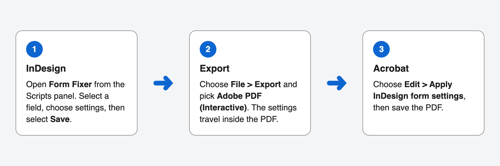
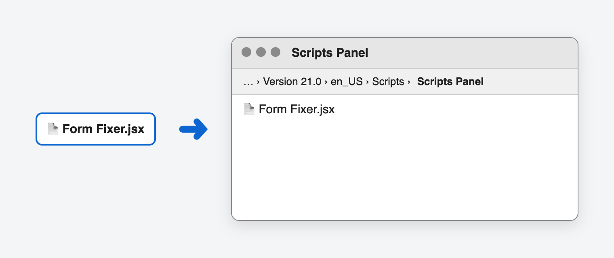
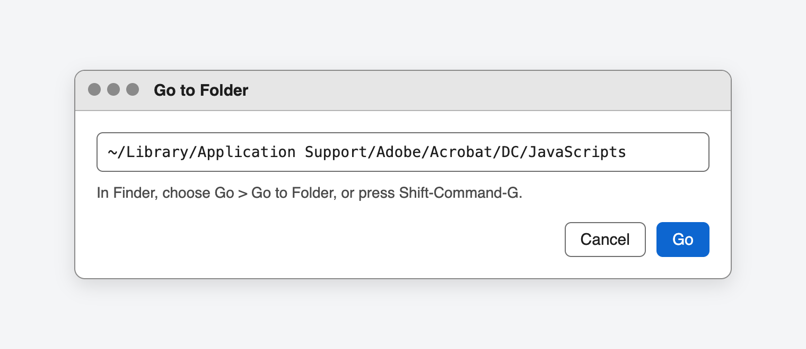
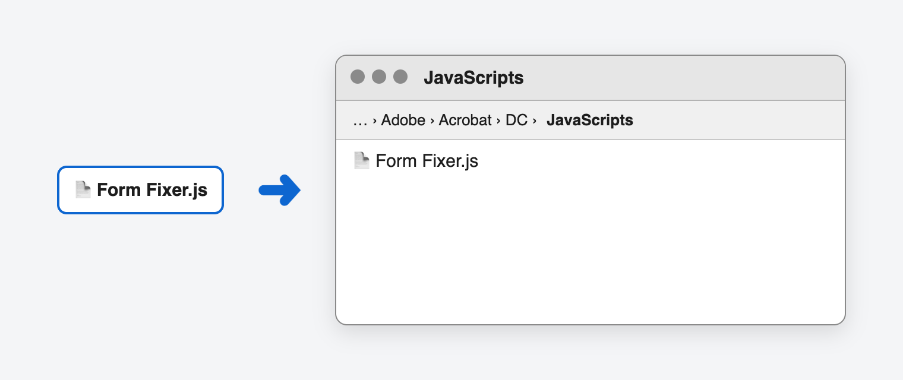
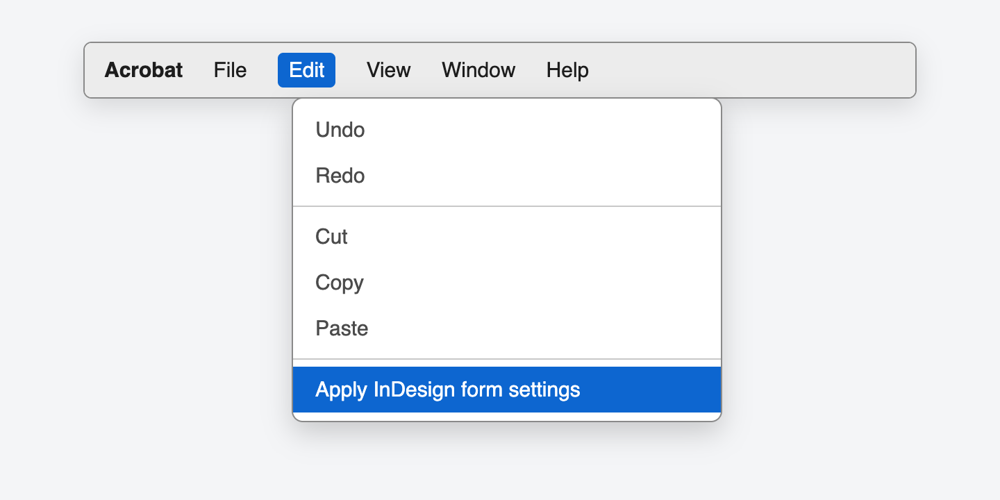
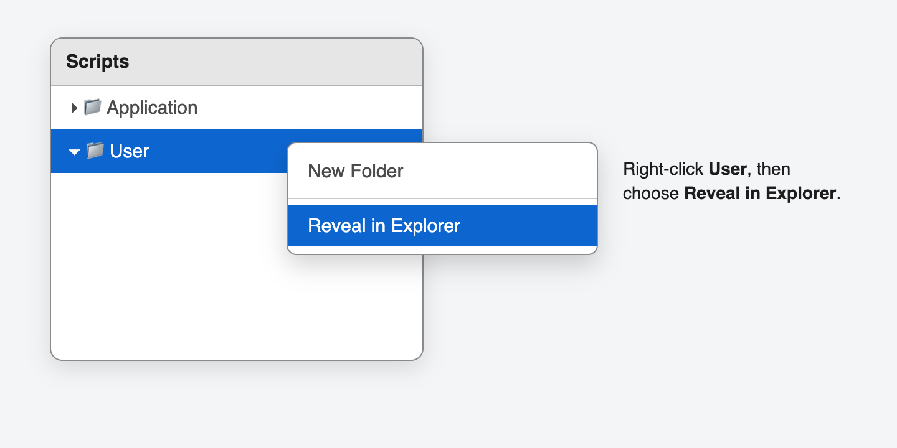
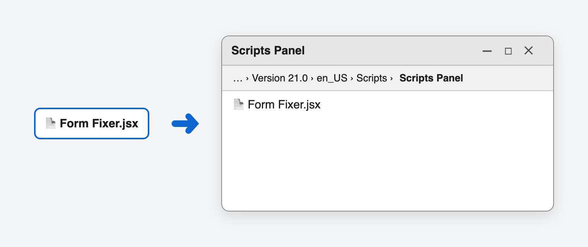
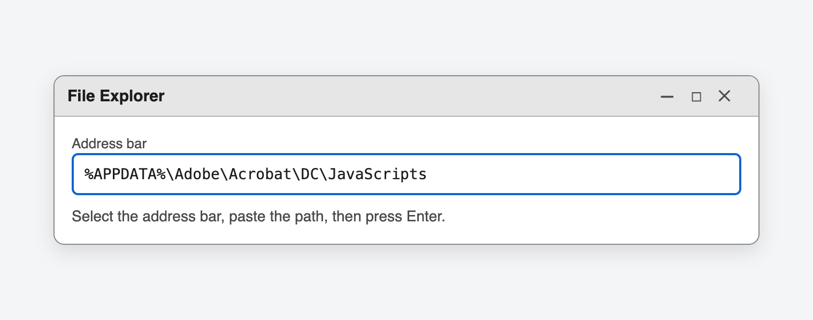
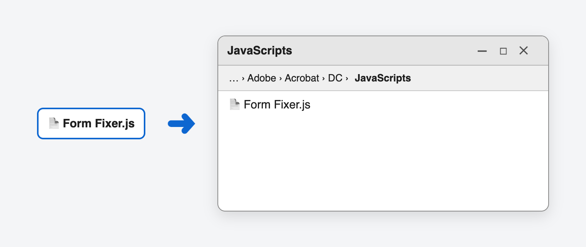
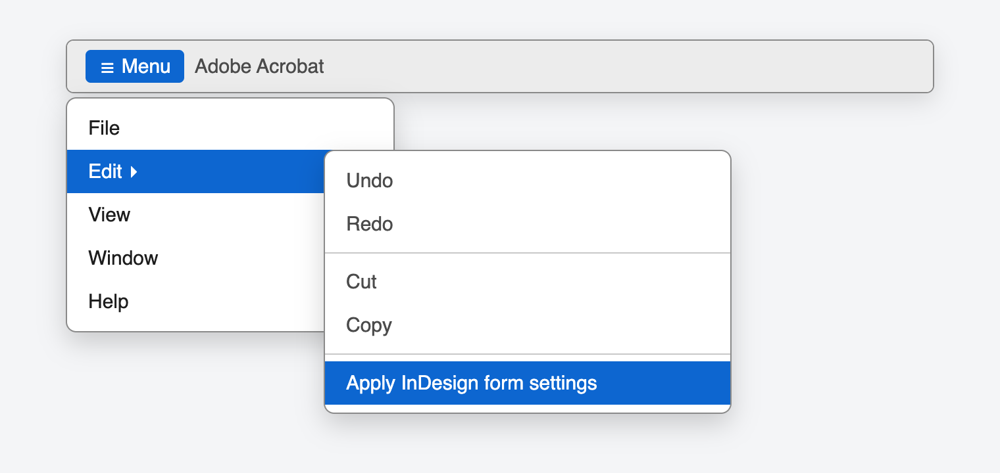

# Install Form Fixer

Form Fixer has two parts. Install both on each computer that builds forms.

- **Form Fixer.jsx** goes in InDesign. It adds a panel for choosing form settings.
- **Form Fixer.js** goes in Acrobat. It adds a menu command that applies those settings to the exported PDF.

## What you need

- InDesign 2024 or later
- Acrobat Pro. Acrobat Reader can't change form fields.

## Get the files

1. On the Form Fixer GitHub page, select **Releases**, then download **Form-Fixer.zip** from the latest release.
2. Open the ZIP file. It has a **Form Fixer** folder with:
   - `Form Fixer.jsx`, for InDesign
   - `Form Fixer.js`, for Acrobat
   - `Form Fixer demo.pdf`, every setting already applied, so you can try them
   - `Form Fixer sample.pdf`, the same form before the Acrobat step, for checking your install
   - `Install Form Fixer.html`, this guide
   - `Use Form Fixer.html`, how to use Form Fixer
   - `Keyboard and screen reader guide.html`
   - `LICENSE.txt`, the license

## Mac

### Install in InDesign

1. Open InDesign and choose **Window > Utilities > Scripts**.
2. In the Scripts panel, right-click **User** and choose **Reveal in Finder**.

   

3. In Finder, open the **Scripts Panel** folder.
4. Copy `Form Fixer.jsx` into the **Scripts Panel** folder.

   

5. In InDesign, open the **User** folder in the Scripts panel. Double-click **Form Fixer.jsx** to open the panel.

### Install in Acrobat

1. Quit Acrobat.
2. In Finder, choose **Go > Go to Folder**, or press Shift-Command-G.
3. Paste this path and select **Go**:

   `~/Library/Application Support/Adobe/Acrobat/DC/JavaScripts`

   

   If Finder says the folder can't be found, go to `~/Library/Application Support/Adobe/Acrobat/DC` instead. Create a new folder there named `JavaScripts`, then open it.

4. Copy `Form Fixer.js` into the **JavaScripts** folder.

   

5. Open Acrobat. Open a PDF and choose **Edit**. You should see **Apply InDesign form settings**.

   

## Windows

Windows hides file extensions by default. If you see `Form Fixer` without `.jsx` or `.js`, that's fine. Don't rename the files.

### Install in InDesign

1. Open InDesign and choose **Window > Utilities > Scripts**.
2. In the Scripts panel, right-click **User** and choose **Reveal in Explorer**.

   

3. In File Explorer, open the **Scripts Panel** folder.
4. Copy `Form Fixer.jsx` into the **Scripts Panel** folder.

   

5. In InDesign, open the **User** folder in the Scripts panel. Double-click **Form Fixer.jsx** to open the panel.

### Install in Acrobat

1. Close Acrobat.
2. Open File Explorer. Select the address bar, paste this path, then press Enter:

   `%APPDATA%\Adobe\Acrobat\DC\JavaScripts`

   

   If Windows says it can't find the folder, go to `%APPDATA%\Adobe\Acrobat\DC` instead. Create a new folder there named `JavaScripts`, then open it.

3. Copy `Form Fixer.js` into the **JavaScripts** folder.

   

4. Open Acrobat and open a PDF. Select **Menu**, then **Edit**. You should see **Apply InDesign form settings**.

   

## Check that it works

1. Open `Form Fixer sample.pdf` from the ZIP in Acrobat.
2. Choose **Edit > Apply InDesign form settings**. On Windows, select **Menu** first.
3. Acrobat says how many fields it updated. Open any field's properties to see its settings.

To see how the finished form should work, compare it with the [Form Fixer demo](samples/Form%20Fixer%20demo.pdf).

Next, follow [Use Form Fixer](USE.md) to add settings to your own form.

## If something doesn't work

- **The Acrobat menu command is missing.** Make sure Acrobat was closed while you copied the file, then open it again. Also check that **Preferences > JavaScript > Enable Acrobat JavaScript** is on.
- **You can't find the Acrobat folder.** In Acrobat, press Command-J on Mac or Ctrl-J on Windows to open the JavaScript console. Type `app.getPath("user", "javascript")`, select it, and press Ctrl-Enter. Acrobat shows the folder to use.
- **Form Fixer isn't in the InDesign Scripts panel.** Make sure the file is directly inside **Scripts Panel**, not inside another folder, and that its name ends in `.jsx`.

## Remove Form Fixer

Delete `Form Fixer.jsx` from the InDesign **Scripts Panel** folder and `Form Fixer.js` from the Acrobat **JavaScripts** folder. Forms you already built keep their settings.
