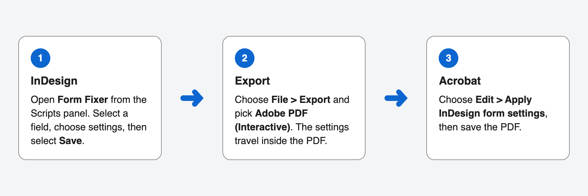

# Form Fixer

Form Fixer adds PDF form settings that InDesign can't create on its own. You choose them in a panel in InDesign, and one menu command in Acrobat applies them to the exported PDF.

## What you can add

- **Formats:** phone number, ZIP code, date, time, numbers, dollars, and percentages
- **Characters:** character limits and comb fields
- **Text:** alignment, default values, and text or check mark color, with a contrast check
- **Choices:** export values for dropdowns and list boxes, and dropdowns where people can type their own answer
- **Checks:** a number range, such as 18 to 99
- **Totals:** sum, product, average, minimum, or maximum of other fields
- **JavaScript:** your own code, for people who need it

## See it in action

Download the [Form Fixer demo](samples/Form%20Fixer%20demo.pdf) and open it in Acrobat or Acrobat Reader. It has one labeled field for every setting, already applied, so you can try each one before you install anything.

## What you need

- InDesign 2024 or later
- Acrobat Pro. Acrobat Reader can't change form fields.

## Get started

1. **Download:** select **Releases** on this page, then download **Form-Fixer.zip** from the latest release.
2. **Install:** follow [Install Form Fixer](INSTALL.md) for Mac or Windows.
3. **Use it:** follow [Use Form Fixer](USE.md) for step-by-step help with your first form.

The download also includes these guides as web pages, plus the demo PDF and a sample PDF for testing your install.

## Keyboard and screen reader use

Form Fixer works with a keyboard and VoiceOver on Mac. See the [keyboard and screen reader guide](KEYBOARD.md).

## Questions and problems

Check **If something doesn't work** in [Install Form Fixer](INSTALL.md). To report a problem or ask a question, select **Issues** on this page.

## License

Form Fixer is licensed under the Apache License, Version 2.0. See [LICENSE](LICENSE).

## Contributing

See [CONTRIBUTING](.github/CONTRIBUTING.md) and our [Code of Conduct](CODE_OF_CONDUCT.md).
