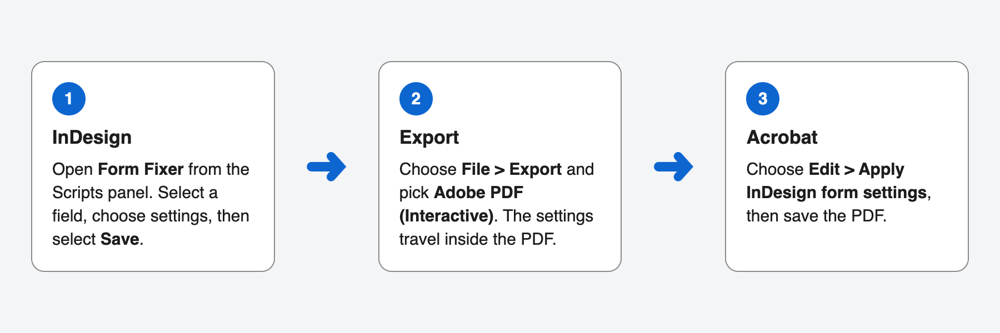
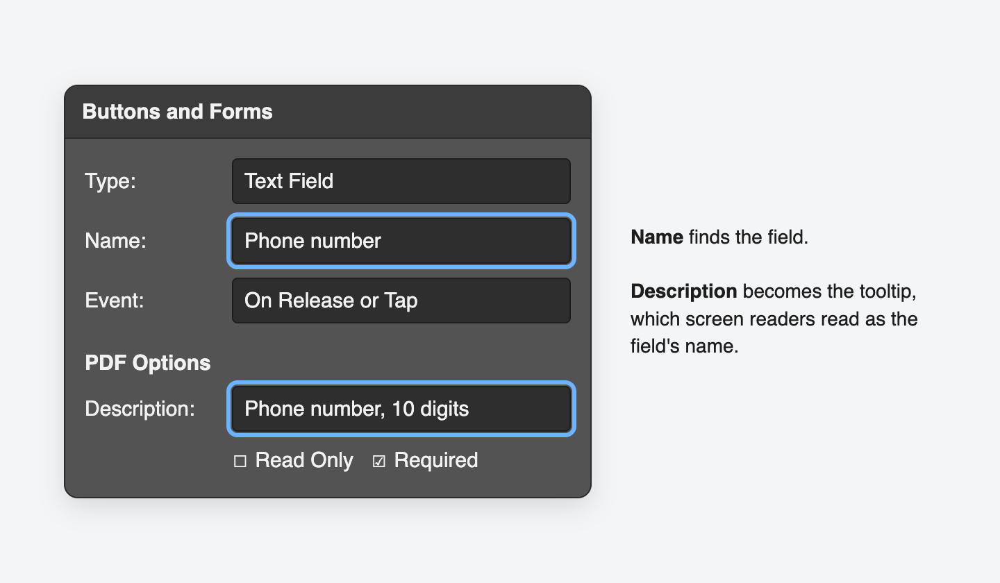
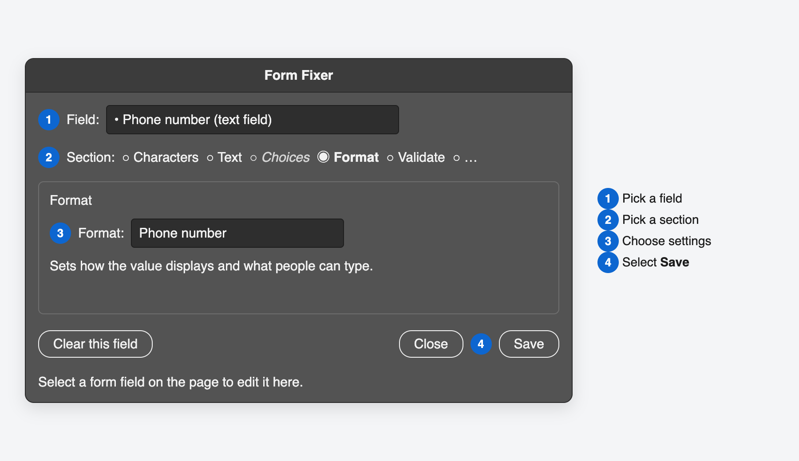
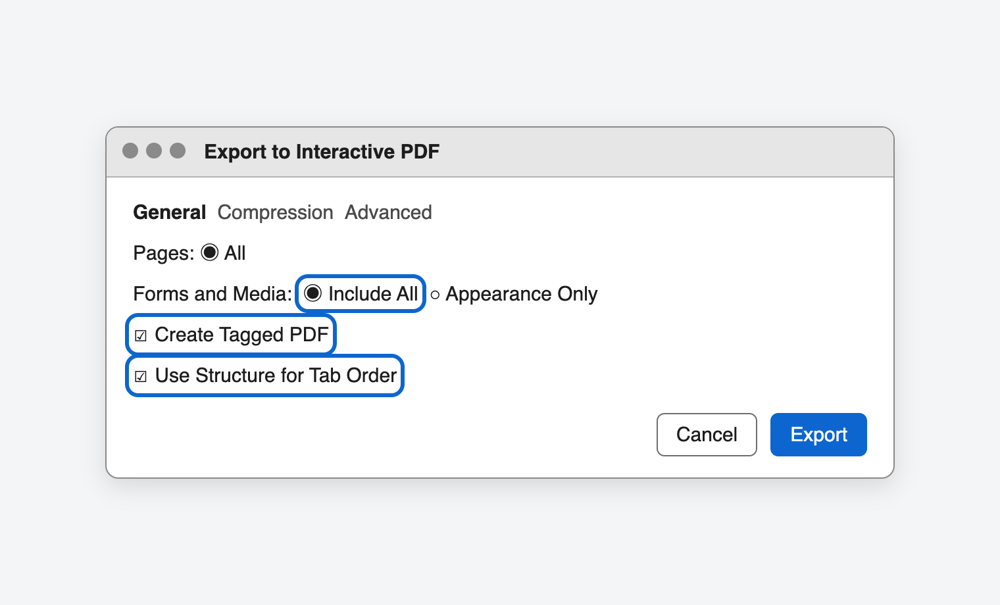
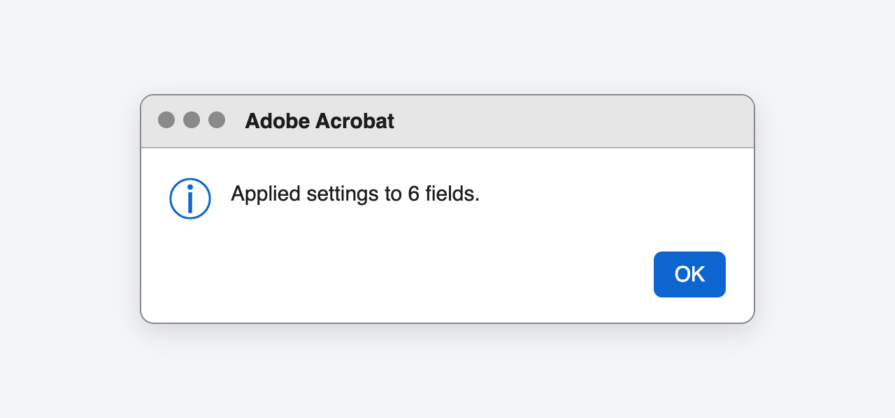

# Use Form Fixer

This guide shows how to add PDF form settings in InDesign that InDesign can't create on its own, such as phone number formats, comb fields, and totals. If you haven't installed Form Fixer yet, start with [Install Form Fixer](INSTALL.md).

You'll work in three places:

1. **InDesign:** build the form, then choose extra settings in the Form Fixer panel.
2. **Export:** export an interactive PDF. The settings travel inside the PDF.
3. **Acrobat:** apply the settings with one menu command, then save.

## Step 1: Build the form in InDesign

Build your form fields the usual way, with **Window > Interactive > Buttons and Forms**. For each field:

1. Give it a clear **Name**, such as "Phone number". Form Fixer and Acrobat use the name to find the field. Each field needs its own name.
2. Fill in **Description** under **PDF Options**. It becomes the field's tooltip, and screen readers read it as the field's name. Start it with the same words as the visible label.

## Step 2: Choose settings in Form Fixer

1. In the Scripts panel (**Window > Utilities > Scripts**), open the **User** folder and double-click **Form Fixer.jsx**. The Form Fixer panel opens and stays open while you work.
2. Select a form field on the page. Its name shows in the **Field** menu. You can also choose a field from that menu.
3. Choose a section, such as **Format**, and pick the settings you want.
4. Select **Save**.

Fields that already have Form Fixer settings start with a bullet in the **Field** menu. To remove every Form Fixer setting from a field, select **Clear this field**, then **Save**.

### What each section does

Sections that don't apply to the selected field are dimmed. For example, **Choices** is only for dropdowns and list boxes.

| Section | What you can set | Where Acrobat shows it |
| --- | --- | --- |
| **Characters** | A character limit. With a limit, you can also make it a comb field, which spaces characters evenly, one per box. | Options tab |
| **Text** | Alignment, a default value, and text color. For check boxes and radio buttons, the color is the check mark color. | Options and Appearance tabs |
| **Choices** | An export value for each choice, such as 1 for First year. For dropdowns, you can also let people type their own answer. | Options tab |
| **Format** | Ready-made formats, such as phone number, ZIP code, date, dollars, or percentage. | Format tab |
| **Validate** | A number range, such as 18 to 99. Leave **From** or **To** empty for no limit. | Validate tab |
| **Calculate** | Make this field the sum, product, average, minimum, or maximum of other fields. Turn on the fields to include. | Calculate tab |
| **JavaScript** | Your own code, or a ready-made example such as an email check. Most people won't need this. | Format, Validate, Calculate, or Actions tab |

### Good to know

- **Default value** is real text in the field, not a placeholder. It stays until someone changes it, so keep the field's visible label.
- **Text color** shows the contrast with the field's fill color. Aim for at least 4.5:1 for text and 3:1 for check marks.
- **Calculate**: make the total field read only in the Buttons and Forms panel, and give it a number format in Form Fixer.
- **Renaming a field:** if you rename a field in InDesign, open Form Fixer and select **Save** again before you export. Don't rename fields in Acrobat, or Form Fixer can't find them.

## Step 3: Export the PDF

1. Choose **File > Export**, choose **Adobe PDF (Interactive)**, then select **Save**.
2. In the export options, turn on:
   - **Forms and Media: Include All**
   - **Create Tagged PDF**
   - **Use Structure for Tab Order**
3. Select **Export**.

## Step 4: Apply the settings in Acrobat

1. Open the PDF in Acrobat Pro.
2. Choose **Edit > Apply InDesign form settings**. On Windows, select **Menu** first, then **Edit**.
3. Acrobat says how many fields it updated. Select **OK**.
4. Save the PDF.

Each export makes a new PDF without the Acrobat settings, so apply them again after every export.

If Acrobat lists a field as not found, the field was renamed or deleted after you saved in Form Fixer. Open Form Fixer, select **Save**, and export again.

## Tips for accessible forms

- **Explain formats in the label.** If a field needs a set format, add a hint below the label that everyone can see, such as "MM/DD/YYYY" or "5 digits". Add the same hint to the field's **Description**, such as "Date signed, MM/DD/YYYY", so screen readers read it too.
- **Describe comb fields.** Sighted people can see how many boxes a comb field has. Put the count in the **Description** too, such as "ZIP code, 5 digits".
- **Check tag order.** If labels and fields read in the wrong order in Acrobat, use InDesign's **Articles** panel to set the reading order, then export again.
- **Try the demo.** The [Form Fixer demo](samples/Form%20Fixer%20demo.pdf) has one labeled field for every setting, already applied. Fill it in to see each setting work, and open each field's properties in Acrobat to see what Form Fixer did.

## Keyboard and screen reader use

See the [keyboard and screen reader guide](KEYBOARD.md).
